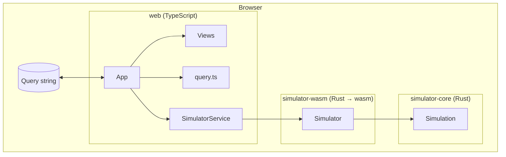

# Architecture

The application consists of three layers. Dependencies only point inwards: the frontend depends on
the bindings, the bindings depend on the core, and the core depends on nothing.



| Layer                                 | Responsibility                                                                                     |
| ------------------------------------- | -------------------------------------------------------------------------------------------------- |
| [`simulator-core`](./core-crate.md)   | All physics: subshell states, microstate tables, term derivation, filters and paging. No I/O.      |
| [`simulator-wasm`](./wasm-bindings.md) | Adapter: converts core types into serializable DTOs and exposes them to JavaScript.              |
| [`web`](./web-frontend.md)            | User interface: URL handling, rendering and user input.                                          |
| [`docs`](./documentation.md)          | This documentation, built separately and served under `/docs/`.                                  |

## Data flow

1. The `App` controller parses the query string into a `SimulationQuery`.
2. `SimulatorService` creates a `Simulator` (wasm) for the electron counts and caches it, so
   filtering and paging do not recompute the terms.
3. The simulator returns the summary, the terms and one page of microstates as plain objects.
4. The views render these objects. User actions produce a new `SimulationQuery`, which is
   written to the URL and rendered again.

The URL is the only state of the application (see
[decision 0003](./decisions/0003-url-as-single-source-of-truth.md)).

## Build output

`npm run build` produces one static site in `dist/`:

```text
dist/
├── index.html        Simulator
├── assets/           Bundled JavaScript, CSS and the .wasm module
└── docs/             Documentation
```

The simulator uses relative URLs and works under any path. The documentation needs its path at
build time (see [Deployment](./deployment.md#base-path)).
